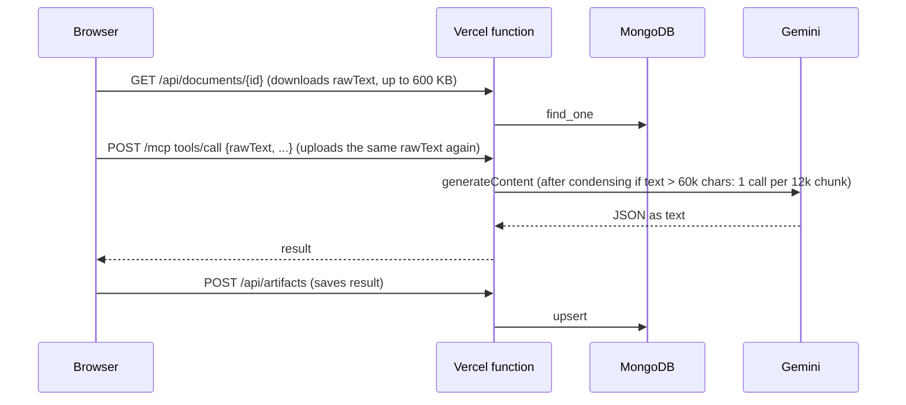

# Architecture Review — NotebookLM Studio

**Reviewed:** `main` at `6937edd` (2026-11-15), production `notebooklm-dusky.vercel.app`.
**Scope:** structure, data flow, deployment, scalability, security, maintainability. Section 7 explains how to run the site on a model other than Gemini.

---

## 1. System overview

```mermaid
flowchart LR
  subgraph Browser["Browser (React 19 + Vite SPA)"]
    UI[ProjectsHome / ProjectWorkspace<br/>viewers, ChatAssistant, NotesPanel]
    PDF[pdfParser<br/>PDF.js + Tesseract OCR]
    VS[VideoStudio<br/>three.js + MediaRecorder]
    EXP[Exports<br/>jsPDF / pptxgenjs / CSV / MD]
    API_JS[api.js / storage.js / notebookLMEngine.js]
  end

  subgraph Vercel["Vercel"]
    STATIC[Static assets<br/>dist/ + public/ (GLB, FBX, HDR)]
    FN["Python function api/index.py<br/>→ FastAPI app (mcp_server.py + security.py)"]
  end

  subgraph External
    GEM[(Gemini API<br/>text + TTS)]
    MONGO[(MongoDB Atlas)]
    POLL[(Pollinations<br/>images)]
  end

  UI --> API_JS
  PDF --> UI
  API_JS -- "REST /api/* (storage, tts)" --> FN
  API_JS -- "JSON-RPC /mcp (AI tools)" --> FN
  FN --> GEM
  FN --> MONGO
  FN -. builds image URLs + warm-up .-> POLL
  UI -- "&lt;img src&gt; per viewer" --> POLL
  VS --> STATIC
  VS -- "/api/tts" --> FN
```

| Layer | What it is | Size |
|---|---|---|
| Frontend | React SPA, no router, no state library; `App.jsx` switches between two views with `useState` | ~5,500 lines JS/JSX; `ProjectWorkspace.jsx` 935, `VideoStudio.jsx` 1,300 (+19 studio modules, 2,200) |
| PDF ingestion | Client-side PDF.js text layer; Tesseract OCR for pages with <40 chars of text | lazy-loaded chunk (445 kB) |
| API | One FastAPI app: REST storage, JSON-RPC `/mcp` with 10 AI tools, `/api/tts`, auth and rate limiting | `mcp_server.py` 1,217 lines, `security.py` 225 |
| AI | `call_gemini()` (one function, three-model fallback chain) used by 11 generators, chat and long-document condensing | 11 prompt templates inline |
| Storage | MongoDB via Motor: `projects`, `documents`, `artifacts`, `notes`, scoped by `ownerId` | no indexes |
| Hosting | Vercel: static SPA + one Python function (Fluid compute, iad1, 300 s max) | — |

---

## 2. Main request flows

**Upload:** the browser parses the PDF (PDF.js/OCR) and builds `rawText` with `--- Page N ---` markers → `POST /api/documents` stores the full text in Mongo.

**Generate (any tool):**

**Chat:** same round trip; the server picks the best-matching pages by keyword (`retrieve_pages`) and returns `[Page N]` citations.
**Narration:** `VideoStudio` → `POST /api/tts` → Gemini TTS (or SAPI/espeak) → WAV → recorded with the 3D scene in the browser.

---

## 3. What is good

- **One choke point for the LLM** (`call_gemini`) makes provider changes cheap (§7).
- **Heavy work stays in the browser:** PDF parsing, OCR, exports and 3D rendering, so the serverless function stays small.
- **Security basics are in place:**
  - access-key auth with per-key data isolation;
  - model output HTML-escaped in chat;
  - CORS allowlist;
  - body/document size caps;
  - fail-closed on Vercel when no keys are configured.
- **Long-document handling:** map-reduce condensing plus page-aware retrieval with citations, verified on production with a 126k-character document.
- **Lazy-loaded heavy tabs:** main bundle 496 kB; the 3D studio, OCR and PDF parser load on demand.
- **Tests exist for the server:** security, concurrency, config. Dead code was removed in PR #7.

---

## 4. Issues and recommendations (by priority)

### A. Data flow and API design

| # | Issue | Recommendation |
|---|---|---|
| A1 | **The browser downloads `rawText` and uploads it again on every generation and chat message** (up to 600 KB each way). It also hits Vercel's ~4.5 MB body cap with synthesis over several large docs, and the server must trust whatever text the client sends. | `/mcp` tools take `{projectId, docId}`; the server loads text from Mongo (owner-scoped). The client never re-uploads documents. This also enables server-side caching (A4). |
| A2 | **`/mcp` is not the Model Context Protocol.** It's a custom JSON-RPC (no `initialize`, `tools/list` has no `inputSchema`), so real MCP clients can't use it, and the name misleads. | Either rename to plain REST (`POST /api/projects/{id}/docs/{docId}/generate/{tool}`, simplest) or implement real MCP (Streamable HTTP) as a separate endpoint if external agents should use it. |
| A3 | **Long synchronous requests:** 15–145 s per generation (100+ s when Gemini returns 429). Fragile on mobile and behind proxies; one request ties up a function instance. | Job pattern: `POST …/generate` → `{jobId}`; work runs in the background (Vercel `waitUntil`, or a queue such as QStash or Inngest); the client polls `GET /api/jobs/{id}` or listens over SSE. |
| A4 | No result cache: regenerating or re-requesting the same input costs quota again. The condense cache is per instance (lost on scale-out). | Cache in Mongo keyed by `sha256(text) + tool + options + model`. |
| A5 | **N+1 requests on document switch:** `ProjectWorkspace` fires one `getArtifact` per tab (12 requests), which spun up ~10 instances in testing. | `GET /api/projects/{id}/artifacts?docId=…` returns all artifacts in one call. |
| A6 | Artifacts are keyed by a concatenated string, chat lives in an artifact array, and there are no versions. | Proper documents: `{projectId, docId, tool, version, model, createdAt, data}`; separate `messages` collection. |

### B. Backend structure

| # | Issue | Recommendation |
|---|---|---|
| B1 | `mcp_server.py` (1,217 lines) mixes app setup, middleware, schemas, storage routes, TTS, LLM client, retrieval, prompts and generators. | Split into a package:<br/>`app/main.py` (FastAPI, middleware, lifespan)<br/>`app/routes/{storage,tools,tts}.py`<br/>`app/llm/` (providers, §7)<br/>`app/prompts/*.txt` or `prompts.py`<br/>`app/rag.py` (chunking, retrieval, citations)<br/>`app/tts/`<br/>`app/db.py` (indexes, repositories)<br/>`app/settings.py` |
| B2 | Prompts are inline f-strings with JSON examples; `parse_json` scrapes the first `{…}`/`[…]` from free text. | Use structured output (Gemini `responseSchema`, OpenAI `json_schema`). Validate with Pydantic models per tool and retry once on validation failure. |
| B3 | Config read ad hoc via `os.getenv` in 3 files; model names hard-coded. | One `Settings` (pydantic-settings) object, validated at startup, logged as a redacted summary. |
| B4 | In-memory state on serverless: rate-limit counters, auth lockout, condense cache. **Measured ineffective on production.** | Shared store (Upstash Redis free tier, or a Mongo TTL collection). |
| B5 | Mongo connection pinned at cold start with a 1 s timeout; if the ping fails, the instance silently serves empty data for its lifetime. | Lazy connect with retry; return 503 when the DB is down (the UI already has an offline banner). |
| B6 | Observability is `print()`. | Structured JSON logs with request id, owner, tool, model, latency, tokens and error class. Track a per-key usage counter in Mongo; optional Sentry. |

### C. Frontend structure

| # | Issue | Recommendation |
|---|---|---|
| C1 | No router: no deep links, the browser Back button leaves the app, and a refresh returns to Projects. | `react-router`: `/`, `/p/:projectId`, `/p/:projectId/d/:docId/:tab`. |
| C2 | `ProjectWorkspace.jsx` (935 lines, 15 `useState`) owns fetching, generation, uploads, downloads and rendering; two effects have missing dependencies (lint warnings). | Extract hooks: `useProject`, `useDocuments`, `useArtifacts`, `useGenerate`. Use TanStack Query for fetching, caching and retries (removes manual state and the N+1). One component per tab. |
| C3 | `storage.js` silently falls back to an in-memory store on any error, mixing "server down" with real data. | Keep the banner; on write failure show an error toast instead of pretending to save. |
| C4 | `VideoStudio.jsx` 1,300 lines; default avatars are 76 MB of FBX. | Split scene setup, recording and UI; ship compressed GLB avatars (≤5 MB). |
| C5 | Plain JS, no frontend tests. | TypeScript (start with `utils/` and API types); Playwright smoke tests (the flows used in testing) in CI. |
| C6 | Access key in `localStorage` (readable by any XSS). | Acceptable for shared keys. If users and accounts come later, move to an httpOnly session cookie (e.g. Auth.js, Clerk or Supabase Auth). |

### D. Security

- **Access model:** shared static keys, no user accounts, no per-user revocation besides editing env vars and redeploying. Fine for a small team. For public use, add real auth (OAuth/email), then per-user quotas.
- **Prompt injection:** document text goes straight into prompts. Output is rendered as text (React escaping; chat escaped before formatting), so the risk is limited to misleading content. Keep `dangerouslySetInnerHTML` confined to `ChatAssistant`'s escaped renderer.
- **Third-party image calls:** prompts derived from document content are sent to Pollinations in image URLs from every viewer's browser, leaking document topics to a third party. Generate server-side (A3 job) and store images in Vercel Blob.
- **Supply chain:** `npm audit` is clean after PR #7; Python deps are unpinned. Pin them and add Dependabot.

### E. Deployment and operations

- Vercel missed one production deploy (PR #6). **Add a post-deploy check:** a GitHub Action compares the production deployment SHA with `main` and runs a smoke test (site 200, API 401 without key, 200 with key, `/` reports `gemini: configured`).
- **Pin the runtime:** `.python-version` (3.12) and `"functions": {"api/index.py": {"maxDuration": 300}}` in `vercel.json`.
- **Unused env vars on Vercel:** `BLOB_*` are unused; use them for images/audio (D) or remove.

---

## 5. Target architecture

```mermaid
flowchart LR
  B[SPA with router + TanStack Query] -->|REST /api/...| API
  subgraph API["FastAPI package (Vercel function)"]
    R[routes] --> S[services: generate / chat / tts]
    S --> L[llm.providers: gemini | openai-compatible | anthropic]
    S --> C[(cache + jobs + rate limits)]
    S --> D[db repositories + indexes]
  end
  L --> G[(LLM provider(s))]
  D --> M[(MongoDB Atlas)]
  C --> RD[(Upstash Redis or Mongo TTL)]
  S --> BL[(Vercel Blob: images, audio)]
  S --> IMG[(Image provider)]
```

**Migration order** (each step shippable on its own):
1. LLM provider interface (§7). Small, unblocks cost and quota problems.
2. Tools take `docId` instead of `rawText`, plus a batch artifacts endpoint (A1, A5).
3. Split `mcp_server.py` into the package (B1) and add Settings (B3).
4. Shared rate limits (B4) and lazy DB connect (B5).
5. Jobs and caching for generation (A3, A4); server-side images into Blob.
6. Frontend router and hooks (C1, C2); then TypeScript and Playwright CI (C5).

---

## 6. Capacity snapshot (from production testing)

| Resource | Current limit | Effective capacity |
|---|---|---|
| Gemini (free tier, per third-party reports) | ~5 RPM / ~20 RPD per model | ~20 short generations a day per model; one 600k-char doc costs ~51 calls |
| Gemini Tier 1 (billing on) | ~1,000+ RPM | then the app's own 20 AI calls/min per key is the cap |
| Vercel function | 300 s, ~4.5 MB request body | long docs under 429 retries approach the limit |
| Rate limits / lockout | per instance (in memory) | not enforced across instances (measured) |

---

## 7. Using a model other than Gemini

Every text-generation path calls one function, `call_gemini(prompt) -> str`, at `mcp_server.py:522`. Its callers are the 9 `gen_*` generators, `answer_question` (chat) and `condense_text` (long docs). Swapping the model means replacing that function with a provider-neutral one. **No frontend change is needed** apart from UI labels.

### Step 1 — Choose a provider and model

Check these four things on the provider's current model list (names and free tiers change often):
- **Context window ≥ 32k tokens.** The app sends up to 60,000 chars (~15k tokens) per call, plus prompt and output. Smaller windows work if you lower the budgets (Step 5).
- **Output ≥ 8k tokens.** Slide decks and reports are long JSON.
- **Reliable JSON** (a JSON / structured-output mode is best).
- **Rate limits that fit your traffic.**

Most providers expose an **OpenAI-compatible** `/chat/completions` endpoint, so one client covers them all:

| Provider | Base URL | Notes |
|---|---|---|
| OpenAI | `https://api.openai.com/v1` | `json_schema` structured output |
| Groq | `https://api.groq.com/openai/v1` | very fast; small free tier |
| OpenRouter | `https://openrouter.ai/api/v1` | one key, hundreds of models, `:free` variants |
| Mistral | `https://api.mistral.ai/v1` | |
| Together | `https://api.together.xyz/v1` | open-weight models |
| DeepSeek | `https://api.deepseek.com` | |
| Cloudflare Workers AI | `https://api.cloudflare.com/client/v4/accounts/<ACCOUNT_ID>/ai/v1` | 10k neurons/day free |
| Ollama (self-hosted) | `http://localhost:11434/v1` | free, local; not reachable from Vercel unless exposed |
| Gemini (compat mode) | `https://generativelanguage.googleapis.com/v1beta/openai` | lets Gemini share the same client |
| Anthropic Claude | `https://api.anthropic.com/v1/messages` | own API shape (adapter below) |

### Step 2 — Add configuration

`.env` / Vercel → Project → Settings → Environment Variables:

```bash
LLM_PROVIDER=openai_compat         # gemini | openai_compat | anthropic
LLM_BASE_URL=https://api.groq.com/openai/v1
LLM_API_KEY=...                    # the provider's key (never commit it)
LLM_MODELS=model-a,model-b         # ordered fallback chain, from the provider's model list
LLM_MAX_OUTPUT_TOKENS=8192
LLM_TIMEOUT_S=90
# optional: a cheaper model just for condensing long documents
LLM_CONDENSE_MODEL=
# optional: lower these for models with small context windows (chars, ~4 chars per token)
LLM_MAX_DIRECT_CHARS=60000
LLM_CHUNK_CHARS=12000
LLM_CHAT_CONTEXT_CHARS=30000
```

### Step 3 — Add a provider module (`llm.py`)

```python
"""Provider-neutral text generation. call_llm(prompt) -> str"""
import json, os, time, urllib.request, urllib.error

PROVIDER = os.getenv("LLM_PROVIDER", "gemini")
BASE_URL = os.getenv("LLM_BASE_URL", "").rstrip("/")
API_KEY = os.getenv("LLM_API_KEY") or os.getenv("GEMINI_API_KEY", "")
MODELS = [m.strip() for m in os.getenv("LLM_MODELS", "").split(",") if m.strip()]
MAX_OUT = int(os.getenv("LLM_MAX_OUTPUT_TOKENS", "8192"))
TIMEOUT = int(os.getenv("LLM_TIMEOUT_S", "90"))


class LLMError(RuntimeError):
    pass


def _post(url: str, headers: dict, body: dict) -> dict:
    req = urllib.request.Request(url, data=json.dumps(body).encode(), method="POST",
                                 headers={"Content-Type": "application/json", **headers})
    return json.loads(urllib.request.urlopen(req, timeout=TIMEOUT).read().decode())


def _openai_compat(model: str, prompt: str, json_mode: bool) -> str:
    body = {"model": model, "max_tokens": MAX_OUT, "temperature": 0.7,
            "messages": [{"role": "user", "content": prompt}]}
    if json_mode:
        # json_object mode only allows a top-level OBJECT; see Step 6 for array tools.
        body["response_format"] = {"type": "json_object"}
    data = _post(f"{BASE_URL}/chat/completions", {"Authorization": f"Bearer {API_KEY}"}, body)
    return data["choices"][0]["message"]["content"]


def _anthropic(model: str, prompt: str, json_mode: bool) -> str:
    data = _post("https://api.anthropic.com/v1/messages",
                 {"x-api-key": API_KEY, "anthropic-version": "2023-06-01"},
                 {"model": model, "max_tokens": MAX_OUT,
                  "messages": [{"role": "user", "content": prompt}]})
    return "".join(block.get("text", "") for block in data["content"])


def _gemini(model: str, prompt: str, json_mode: bool) -> str:
    cfg = {"temperature": 0.7, "maxOutputTokens": MAX_OUT}
    if json_mode:
        cfg["responseMimeType"] = "application/json"
    data = _post(f"https://generativelanguage.googleapis.com/v1beta/models/{model}:generateContent",
                 {"x-goog-api-key": API_KEY},
                 {"contents": [{"parts": [{"text": prompt}]}], "generationConfig": cfg})
    return data["candidates"][0]["content"]["parts"][0]["text"]


PROVIDERS = {"openai_compat": _openai_compat, "anthropic": _anthropic, "gemini": _gemini}


def call_llm(prompt: str, json_mode: bool = False, models: list | None = None) -> str:
    if not API_KEY:
        raise LLMError("LLM_API_KEY is not set on the server.")
    fn = PROVIDERS[PROVIDER]
    last = None
    for model in models or MODELS:
        for attempt in range(3):
            try:
                return fn(model, prompt, json_mode)
            except urllib.error.HTTPError as e:
                last = e
                if e.code in (429, 500, 502, 503):
                    retry = e.headers.get("Retry-After")
                    time.sleep(min(float(retry) if retry and retry.isdigit() else 2 ** attempt, 20))
                    continue
                break  # 4xx other than 429: try the next model
            except Exception as e:
                last = e
                break
    raise LLMError(f"All models failed: {last}")
```

### Step 4 — Point the app at it

In `mcp_server.py`, replace the body of `call_gemini` (keeping the name means the 12 call sites don't change):

```python
from llm import call_llm, LLMError

def call_gemini(prompt: str) -> str:   # kept for compatibility; now provider-neutral
    return call_llm(prompt)
```

Then update:
- `require_gemini_key()` → check `llm.API_KEY`.
- The startup warning.
- `GET /` should report `"llm": {"provider": PROVIDER, "models": MODELS}`.
- The `except (TTSUnavailable, GeminiNotConfigured)` clauses: also catch `LLMError`.

Later, rename `call_gemini` → `call_llm` across the file.

### Step 5 — Match the context budgets to the model

At `mcp_server.py` (long-document section), read the budgets from env:

```python
MAX_DIRECT_CHARS = int(os.getenv("LLM_MAX_DIRECT_CHARS", "60000"))
CHUNK_CHARS = int(os.getenv("LLM_CHUNK_CHARS", "12000"))
CHAT_CONTEXT_CHARS = int(os.getenv("LLM_CHAT_CONTEXT_CHARS", "30000"))
```

Rule of thumb: `LLM_MAX_DIRECT_CHARS ≈ (context_tokens − max_output_tokens − 1,000) × 3.5`. For an 8k-context model, use about 12,000 / 4,000 / 8,000.

To save money, use `LLM_CONDENSE_MODEL` (a small, cheap model) inside `condense_text`: `call_llm(prompt, models=[CONDENSE_MODEL])`.

### Step 6 — Keep JSON reliable

- Six tools return a JSON **object** (mind map, infographic, study guide, report, data table, synthesis). Three return a JSON **array** (audio script, slides, slides with images). Chat returns plain text, so call it with `json_mode=False`.
- OpenAI-style `json_object` mode rejects top-level arrays. Either leave `json_mode=False` for those three (the existing `parse_json` already strips code fences and extracts the array), or change their prompts to return `{"turns": [...]}` / `{"slides": [...]}` and unwrap.
- Best: pass a JSON Schema (`response_format: {"type": "json_schema", ...}` on OpenAI-compatible APIs that support it; `responseSchema` on Gemini) and validate with Pydantic. On a validation error, retry once with "Return only valid JSON matching the schema."

### Step 7 — Narration, images and UI text

- **Narration** is independent of the text model:
  - keep Gemini TTS (`GEMINI_API_KEY`);
  - set `TTS_BACKEND=espeak` (free, robotic);
  - or add an OpenAI TTS backend (`POST {base}/audio/speech` with `response_format: "wav"`) as a fourth entry in `TTS_BACKENDS`.
- **Images** come from Pollinations, not Gemini, so nothing changes.
- **UI labels** say "Gemini" in five places:
  - `ProjectsHome.jsx:51`
  - `ProjectWorkspace.jsx:49, 721, 733, 744`
  - `ChatAssistant.jsx:66`

  Replace them with a neutral "AI" label, or a `VITE_AI_LABEL` env value.

### Step 8 — Test and deploy

1. Locally:
   ```bash
   LLM_PROVIDER=openai_compat LLM_BASE_URL=... LLM_API_KEY=... LLM_MODELS=... python mcp_server.py
   ```
   Then generate every tool once on a 3-page PDF and a 100k+-char PDF (exercises condensing), and ask a chat question that needs a late page (check the `[Page N]` citation).
2. Run `python tests/test_security.py tests/test_concurrency.py tests/test_server_config.py`. They stub the model, so they stay provider-agnostic.
3. Add the env vars in Vercel (Production + Preview) and redeploy. Check `GET /` shows the provider, then repeat the smoke test on production.
4. Optional safety net: set `LLM_MODELS` to a chain spanning a primary and a cheaper model. For a cross-provider fallback, call `call_llm` again with a second provider config when the first raises `LLMError`.

### Cost and quality notes

- Every generation is **1 call** for documents up to `LLM_MAX_DIRECT_CHARS`, plus **1 call per chunk** above that. Chat is 1 call per question. Estimate cost as `calls × (input tokens + output tokens) × price`.
- Smaller open models handle chat and condensing well but are weaker at long structured JSON (slides, reports). A good split is a strong model for generators and a small fast one for `LLM_CONDENSE_MODEL`.
